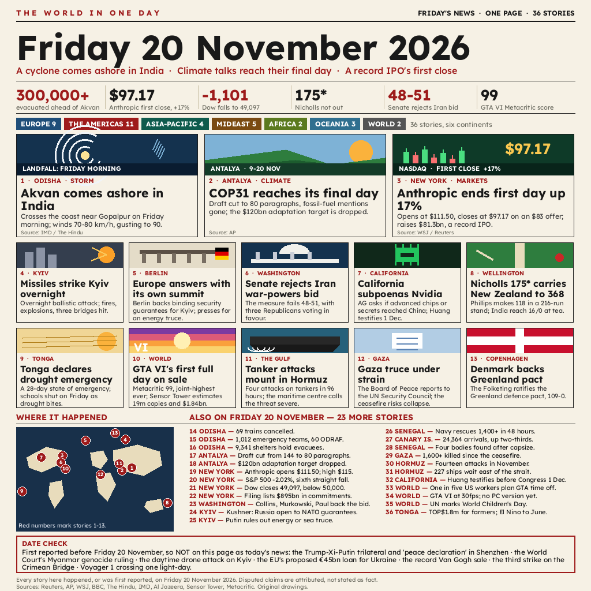

# Friday 20 November 2026 — the world in one page

[](https://make.fun/bounty/news-image-20261120?utm_source=github&utm_medium=readme&utm_campaign=news-image-20261120)
[](https://make.fun/bounty/news-image-20261120/leaderboard?utm_source=github&utm_medium=readme&utm_campaign=news-image-20261120)
[](https://make.fun/bounty/news-image-20261120?utm_source=github&utm_medium=readme&utm_campaign=news-image-20261120)

Entry for the make.fun bounty **“Sum up 20 November's world news in one image”**
($250, top 50, closes 22 Nov 2026 07:00 WIB). One page, 36 stories across
six continents: a giant date headline, a sourced stat strip, 3 hero cards +
10 illustrated cards, a locator map, 23 briefs, and a DATE CHECK box that
names the big stories deliberately left out because they were first reported
before Friday 20 November.



## How it is built

- `draw.py` renders `entry.png` (1024×1024, deterministic) with Pillow,
  using the Lexend variable font in `fonts/` (Google Fonts, SIL OFL).
  Every illustration on the page is drawn in code — no photographs.
- `main.py` is the sandbox entry point (Python 3.13, standard library
  only): it copies the pre-rendered `entry.png` to `/output/entry.png`,
  verifying the PNG magic and the 1 MiB cap. Both runs write identical bytes.

```sh
python3 draw.py            # re-render entry.png (and entry-300.png)
MAKEFUN_OUTPUT_DIR=out python3 main.py   # copy it to out/entry.png
```

## What is on the page

Lead: Severe Cyclone Akvan comes ashore near Gopalpur, India (IMD:
winds 70–80 km/h gusting to 90; 300,000+ evacuated). Also: COP31's final
day in Antalya, Anthropic's record $81.3bn IPO first close ($97.17, +17%),
the overnight missile attack on Kyiv, the Berlin summit, the Senate's
48–51 Iran war-powers vote, California's Nvidia subpoena, Nicholls 175\*
in Wellington, Tonga's drought emergency, GTA VI's first full day
(Metacritic 99), the Hormuz tanker attacks, the Gaza truce under strain,
and Denmark's 109–0 Greenland vote.

DATE CHECK (first reported before 20 Nov, so not today's news): the
Trump–Xi–Putin trilateral in Shenzhen, the World Court's Myanmar ruling,
the daytime drone attack on Kyiv, the EU's proposed €45bn Ukraine loan,
the record Van Gogh sale, the third Crimean Bridge strike, and Voyager 1
crossing one light-day.

Sources: Reuters, AP, WSJ, BBC, The Hindu, IMD, Al Jazeera, Sensor Tower,
Metacritic. Disputed claims are attributed, not stated as fact.

## License

MIT. The Lexend font is licensed under the SIL Open Font License 1.1.
